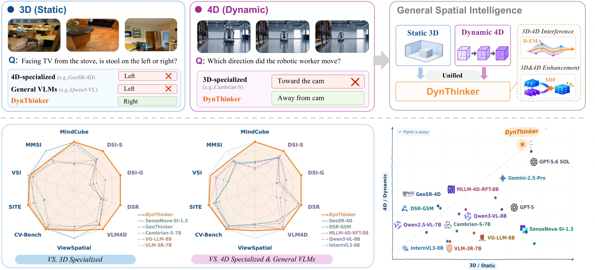
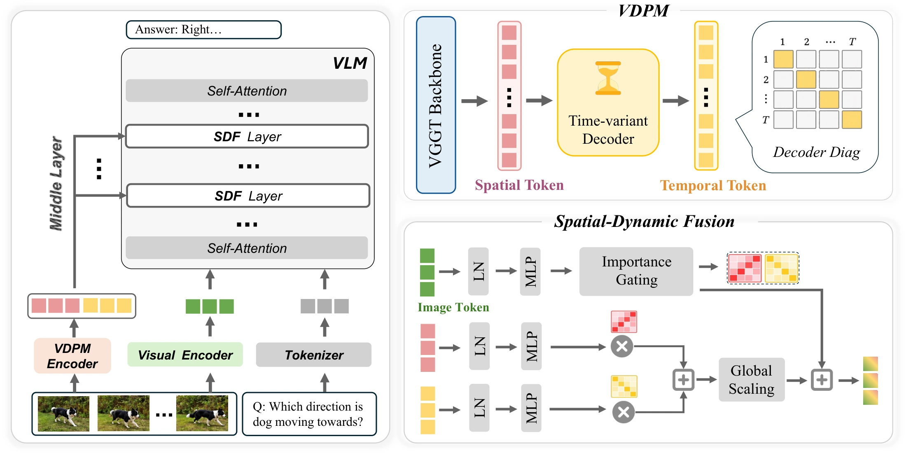

<h1 align="center">DynThinker</h1>
<h3 align="center">Unifying Static 3D and Dynamic 4D Spatial Reasoning</h3>

<p align="center">
  <a href="assets/DynThinker-preprint.pdf"></a>
  <a href="#paper-and-models"></a>
  <a href="#paper-and-models"></a>
</p>

<p align="center">
  Qihang Cao<sup>*</sup>, Haoyuan Li<sup>*</sup>, Zihan Guo, Sensen Gao, Zihui Gao, Huixin Zhang,<br>
  Fan He, Jianhua Han, Hang Xu, Xiaodan Liang, Jia-Wang Bian<sup>✉</sup><br>
  <sup>*</sup> Equal contribution. <sup>✉</sup> Corresponding author.
</p>

**DynThinker brings static geometry and dynamic scene understanding into one vision-language model.**
It combines semantic-guided spatial–dynamic fusion with decoupled weight averaging to jointly strengthen 3D and 4D spatial reasoning.

<p align="center">
  
</p>

## ✨ How it works

- **Spatial-Dynamic Fusion (SDF):** A frozen V-DPM geometry encoder extracts spatial and dynamic features. Semantic gates select and fuse these features into the middle layers of the VLM.
- **Decoupled EMA (D-EMA):** Group-wise weight averaging regulates updates to pretrained parameters while letting the new fusion modules learn with their online weights.

<p align="center">
  
</p>

The repository includes the Qwen3-VL-based model, training, D-EMA checkpoint export, inference, and VSI-Bench / VLM4D evaluation.

## Paper and models

| Resource | Link |
|---|---|
| Paper | [Read the preprint (PDF)](assets/DynThinker-preprint.pdf) |
| arXiv | Coming soon |
| 🤗 DynThinker model weights | Coming soon |
| Base model | [Qwen3-VL-8B-Instruct](https://huggingface.co/Qwen/Qwen3-VL-8B-Instruct) |
| Geometry encoder | [V-DPM](https://github.com/eldar/vdpm) |

## ⚙️ Installation

Use Python 3.10 or newer on Linux with a CUDA GPU. Install PyTorch >= 2.6 for your CUDA version, then:

```bash
git clone https://github.com/QihangCao/DynThinker.git
cd DynThinker
pip install -e .
```

For training, install `pip install -e ".[train]"`. The launcher uses Flash Attention by default; install `pip install -e ".[flash]"` or set `ATTN_IMPLEMENTATION=sdpa`.
The package pins Transformers to 4.57.0.

## 🚀 Inference

Use the final `OUTPUT_DIR` from training, or [export an intermediate D-EMA checkpoint](docs/USAGE.md#d-ema). Public model weights are coming soon. If the checkpoint was saved without V-DPM weights, add `--geometry-encoder-path /path/to/vdpm/model.pt`.

```bash
dynthinker-infer --model /path/to/dynthinker-checkpoint \
    --video clip.mp4 --num-frames 32 \
    --question "Is the car moving towards the camera? Answer yes or no."
```

```python
from dynthinker.inference import DynThinkerPipeline, load_frames

pipe = DynThinkerPipeline("/path/to/dynthinker-checkpoint", device="cuda")
frames = load_frames(video="clip.mp4", num_frames=32)
print(pipe.generate(frames, "How many chairs are in the room? Answer with a number."))
```

## 🛠️ Training

Prepare your data using the [data guide](docs/DATA.md) and [dataset registry template](configs/datasets.example.yaml), then launch training. For SPAR-style annotations, render point/box markers into images and remove `spar_info`, as described in the data guide.

```bash
export MODEL_PATH=Qwen/Qwen3-VL-8B-Instruct
export VDPM_PATH=/path/to/vdpm/model.pt
export DATASET_CONFIG=/path/to/datasets.yaml
export DATASETS="my_spatial_set,my_video_set%50"
export DATASET_SIZE=200000  # total samples after %-sampling; used to derive D-EMA decays
export OUTPUT_DIR=./output/dynthinker
bash scripts/train_dynthinker.sh
```

The launcher defaults to 8 GPUs, 8 frames per video, DeepSpeed ZeRO-2, bf16, and a global batch size of 64. Override options with `EXTRA_ARGS`.
See [training options](docs/USAGE.md#training) and [D-EMA, resume, and export](docs/USAGE.md#d-ema) for configuration details.

## 📊 Evaluation

Download the benchmark annotations and videos, then generate and score predictions. Replace the annotation path below with your local file; for Parquet annotations, install `pip install -e ".[eval]"`.

```bash
dynthinker-eval generate --benchmark vsibench --annotations VSI-Bench/test.jsonl \
    --media-root VSI-Bench --model /path/to/dynthinker-checkpoint \
    --output preds_vsibench.jsonl
dynthinker-eval score --benchmark vsibench --predictions preds_vsibench.jsonl
```

VSI-Bench videos follow `<media-root>/<dataset>/<scene_name>.mp4`. Both `vsibench` and `vlm4d` are supported. See the [evaluation guide](docs/USAGE.md#evaluation) for data paths, generation settings, and resumable runs.

## 📚 Documentation

- [Data preparation](docs/DATA.md)
- [Required weights](docs/USAGE.md#weights-you-need)
- [Configuration](docs/USAGE.md#configuration-notes)
- [D-EMA and checkpoint export](docs/USAGE.md#d-ema)
- [Tests](docs/USAGE.md#tests)

## Citation

```bibtex
@misc{cao2026dynthinker,
  title={DynThinker: Unifying Static 3D and Dynamic 4D Spatial Reasoning},
  author={Qihang Cao and Haoyuan Li and Zihan Guo and Sensen Gao and Zihui Gao and Huixin Zhang and Fan He and Jianhua Han and Hang Xu and Xiaodan Liang and Jia-Wang Bian},
  year={2026},
  note={Preprint}
}
```

## Acknowledgements

We build on [GeoThinker](https://github.com/Li-Hao-yuan/GeoThinker),
[VG-LLM](https://github.com/LaVi-Lab/VG-LLM), [Qwen3-VL](https://github.com/QwenLM/Qwen3-VL),
[V-DPM](https://github.com/eldar/vdpm), [VGGT](https://github.com/facebookresearch/vggt),
[Transformers](https://github.com/huggingface/transformers),
[lmms-eval](https://github.com/EvolvingLMMs-Lab/lmms-eval), and
[thinking-in-space](https://github.com/vision-x-nyu/thinking-in-space).

## License

Original DynThinker code is released under the [MIT License](LICENSE). Components derived from other projects retain their respective licenses (Apache-2.0, MIT, and the VGGT License for V-DPM/VGGT-derived parts); see [Third-party notices](THIRD_PARTY_NOTICES.md) and [license texts](LICENSES/).
